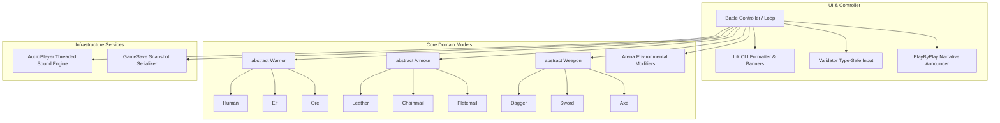
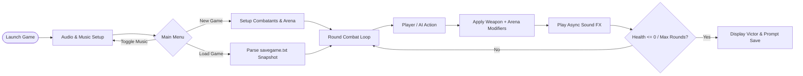

# Java RPG Arena Combat Simulator

[](https://www.oracle.com/java/)
[](LICENSE)
[]()
[]()
[]()

A feature-rich, object-oriented tactical RPG arena simulator and game engine built in Java. Showcases multi-package domain architecture, polymorphic combat mechanics, environmental arena modifiers, multi-threaded audio synthesis via the Java Sound API (`javax.sound.sampled`), snapshot game persistence (`save`/`load`), dynamic play-by-play narrative announcers, dynamic combat balancing, and robust defensive CLI validation.

---

## 📋 Table of Contents

- [Overview](#overview)
- [Key Features](#key-features)
- [System Architecture](#system-architecture)
  - [Subsystem Breakdown](#subsystem-breakdown)
  - [Engine Flow Diagram](#engine-flow-diagram)
- [Core Skills & Engineering Competencies](#core-skills--engineering-competencies)
- [Package & Directory Structure](#package--directory-structure)
- [Getting Started](#getting-started)
  - [Prerequisites](#prerequisites)
  - [Compilation & Execution](#compilation--execution)
- [Gameplay & System Mechanics](#gameplay--system-mechanics)
  - [Arenas & Environmental Modifiers](#arenas--environmental-modifiers)
  - [Audio & Multi-Threading](#audio--multi-threading)
  - [Save / Load Serialization Format](#save--load-serialization-format)
- [License](#license)

---

## 🌟 Overview

The **Java RPG Arena Combat Simulator** is a full-featured console combat engine designed around modularity, separation of concerns, and clean OOP practices. The engine models multi-round sci-fi gladiatorial battles featuring dynamic battlefields, customizable weapons and armours, stamina/dexterity costs, audio playback for combat actions, dynamic rubber-band stat scaling to prevent stale stalemates, and persistent state serialization.

---

## ✨ Key Features

- **Multi-Package Domain Architecture**: Clean separation across 6 discrete modules (`arena`, `armour`, `warrior`, `weapon`, `util`, `sounds`).
- **Environmental Arena Modifiers**: Dynamic battlefields (Asteroid Field, Solar Flare, Crystal Caverns, Dark Nebula, Neutral Zone) that alter offensive output for players and enemies.
- **Multi-Threaded Audio Engine**: Background music playback (`space_battle.wav`) with asynchronous audio threads for hit and miss sound effects (`javax.sound.sampled`).
- **Game State Serialization (`GameSave`)**: Robust file I/O engine supporting full session saving and mid-battle reloading.
- **Narrative Event Announcer (`PlayByPlay`)**: Contextual combat commentary adapting to weapon types, strike intensity, dexterity depletion, and hit/miss results.
- **Dynamic Combat Balancing**: Rubber-band balancing system that automatically buffs combatant attributes during prolonged stalemates.
- **Defensive CLI Validator (`Validator`)**: Exception-safe input loop guarding against format mismatches and out-of-range commands.

---

## 🏛️ System Architecture

### Subsystem Breakdown



### Engine Flow Diagram



---

## 🛠️ Core Skills & Engineering Competencies

| Technical Competency | Description |
| :--- | :--- |
| **Object-Oriented Polymorphism** | Abstract base classes with polymorphic dispatch for entities (`Warrior`), defences (`Armour`), and attacks (`Weapon`). |
| **Multi-Threaded Audio Processing** | Managing concurrent audio playback threads with `javax.sound.sampled.Clip` and `LineListener` auto-cleanup. |
| **Data Persistence & File I/O** | Structured plaintext file parsing and serialization (`PrintWriter` / `Scanner`) with error handling. |
| **Defensive Programming & Validation** | Robust input parsing preventing `InputMismatchException` crashes and handling buffer flushing. |
| **Event-Driven Narrative Generation** | Dynamic message resolution modeling combat outcomes based on granular state attributes. |
| **Game Balance Algorithms** | Algorithmic attribute escalation (dynamic rubber-banding) to maintain pacing during prolonged matches. |

---

## 📁 Package & Directory Structure

```text
java-rpg-arena-combat-simulator/
├── Battle.java             # Main game loop, state orchestration, and turn cycle manager
├── arena/
│   └── Arena.java          # Environmental modifiers, zone selection, and ANSI color themes
├── armour/
│   ├── Armour.java         # Abstract base defense class
│   ├── Chainmail.java      # Medium armor specification
│   ├── Leather.java        # Lightweight agile armor
│   └── Platemail.java      # Heavy protective armor
├── warrior/
│   ├── Warrior.java        # Abstract base entity model
│   ├── Elf.java            # High dexterity agile fighter
│   ├── Human.java          # Balanced baseline warrior
│   └── Orc.java            # High strength tank combatant
├── weapon/
│   ├── Weapon.java         # Abstract base weapon with nested AttackResult class
│   ├── Axe.java            # Heavy damage cleave weapon
│   ├── Dagger.java         # High speed precision weapon
│   └── Sword.java          # Reliable standard weapon
├── util/
│   ├── AudioPlayer.java    # Multi-threaded audio playback engine (Java Sound API)
│   ├── GameSave.java       # Game state serializer and deserializer
│   ├── Ink.java            # Visual UI renderer with ANSI color palettes
│   ├── PlayByPlay.java     # Procedural dynamic combat announcer
│   └── Validator.java      # Robust defensive input parser
├── sounds/
│   ├── hit.wav             # Sound effect for successful attack hits
│   ├── miss.wav            # Sound effect for missed attacks / stamina depletion
│   └── space_battle.wav    # Ambient background music track
├── .gitignore              # Git ignore rules for Java binaries and save files
├── LICENSE                 # MIT License
└── README.md               # Complete repository documentation
```

---

## 🚀 Getting Started

### Prerequisites

- **Java Development Kit (JDK)**: Version 8 or higher (`javac` and `java` available in PATH).
- Compatible audio output device (for sound effects and background music).

### Compilation & Execution

1. **Clone the repository:**
   ```bash
   git clone https://github.com/<your-username>/java-rpg-arena-combat-simulator.git
   cd java-rpg-arena-combat-simulator
   ```

2. **Compile all modules and source files:**
   ```bash
   javac Battle.java arena/*.java armour/*.java warrior/*.java weapon/*.java util/*.java
   ```

3. **Launch the simulator:**
   ```bash
   java Battle
   ```

---

## 🎮 Gameplay & System Mechanics

### Arenas & Environmental Modifiers

| Arena Location | Theme Effect | Player Modifier | Enemy Modifier |
| :--- | :--- | :--- | :--- |
| **Asteroid Field** | Dense asteroids obstruct heavy strikes | -4% Damage | -4% Damage |
| **Solar Flare** | Solar radiation drains combat energy | -6% Damage | Normal (0%) |
| **Crystal Caverns** | Crystalline reflections enhance precision | +4% Damage | -5% Damage |
| **Dark Nebula** | Impaired visibility limits coordination | -5% Damage | -5% Damage |
| **Neutral Zone** | Standard battle conditions | Normal (0%) | Normal (0%) |

### Audio & Multi-Threading

The `AudioPlayer` component manages two audio channels:
- **Background Music**: Synchronous looping background playback on a dedicated audio line (`Clip.LOOP_CONTINUOUSLY`).
- **Sound Effects**: Asynchronous execution via transient `new Thread(...)` workers with `LineListener` lifecycle hooks that immediately release system audio resources upon playback completion (`LineEvent.Type.STOP`).

### Save / Load Serialization Format

The `GameSave` engine writes structured text snapshots (`savegame.txt`) encapsulating all live session metrics:
```text
# SPACE WARS SAVE
ROUND,4
ARENA,Crystal Caverns
PLAYER,1,100,18,12,2,2
ENEMY,3,64,22,8,1,3
```

---

## 📄 License

This project is open-source and licensed under the [MIT License](LICENSE).
